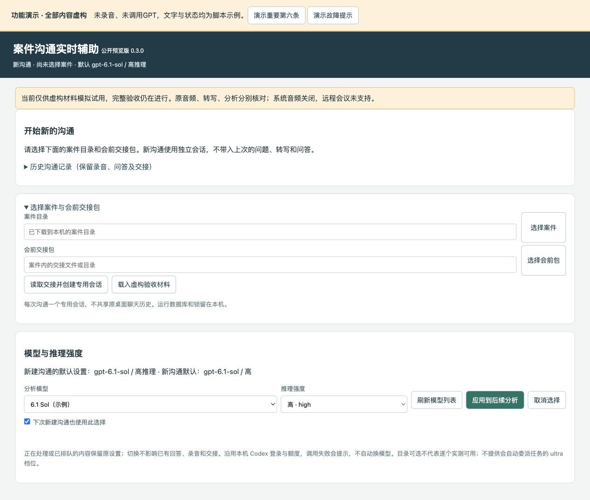

# 案件沟通实时辅助 · Case Meeting Assistant

把会前材料、现场录音转写、GPT追问和会后整理串成一个本地操作流程。页面自动接收稳定转写，在独立Codex会话中结合材料分析，最多显示五条值得当场追问的问题；支持原音频回听、识别纠错、独立问答、处理状态、模型切换和版本化交接。

**一台Mac就能使用；双机交接是可选模式。当前为公开预览版，适合虚构材料模拟试用，尚未完成正式现场使用的全项验收。**



## 先看演示

- [完整页面与功能图解PDF](docs/功能介绍与页面演示.pdf)
- [使用说明](docs/USAGE.md)
- [已验证范围与未完成项](docs/VALIDATION.md)
- [单机与双机工作方式](skills/case-meeting-assistant/references/workflow.md)

## 安装为Codex技能

把本仓库`skills/case-meeting-assistant`安装到`~/.codex/skills/case-meeting-assistant`，然后在Codex中说：

> 请使用 $case-meeting-assistant，按单机模式检查并部署案件沟通实时辅助；先做虚构材料测试。

也可下载仓库，在技能目录运行：

```sh
python3 scripts/install.py --mode single --check
python3 scripts/install.py --mode single
```

安装器编译独立采集器并创建桌面入口，不覆盖官方Wisp、既有私人版、AGENTS或MCP配置。需要macOS 26+、Apple Silicon、Python 3.9+、Apple Command Line Tools、支持本程序协议的官方Codex及ChatGPT登录。不是仅安装SKILL.md就能自动获得录音权限和模型服务。

双机现场端：`--mode dual --role field`；准备端：`--mode dual --role desk`。如已有统一模板目录，附加`--templates <本机路径>`。不同机器各自登录，不复制凭据。安装及回退详见[部署说明](skills/case-meeting-assistant/references/deployment.md)。

## 单机与双机有什么不同

| 阶段 | 一台Mac | 两台Mac |
|---|---|---|
| 会前 | 本机整理材料并生成会前包 | 准备端生成，现场端核对接收 |
| 会中 | 本机录音、自动分析与追问 | 现场端录音、自动分析与追问 |
| 会后 | 同机核对会后包并更新事实/分析 | 准备端核对同步附件后接手 |
| 同步 | 不需要iCloud | 案件目录可用iCloud等；不共享运行数据库 |

## 能做什么

中文语音持续转写与原音频分片保存；自动增量提交；最多五条带原因/影响/来源的追问；已问/已解决/稍后/本次不问；实质新证据恢复需用户决定；用户问答独立保存；转写纠错与受影响分析复核；整场会后草稿；结束保存后回空白首页；只读历史与明确续录；模型及推理强度显式选择。

本地页面只监听回环地址，但GPT分析会通过现有Codex账户将所选材料和转写交给云端模型。只接受ChatGPT登录，不静默改用按API计费服务。法律技能和商业MCP不随包提供账号；未实际核验时仅提出事实问题并标法律待核。默认排除LawMCP和qcc-history，不启用Obsidian。

## 演示与测试

`python3 skills/case-meeting-assistant/scripts/demo.py`启动无麦克风、无模型请求的虚构页面。预置结果只是交互示范，不是现场AI或语音准确率证明。

```sh
PYTHONPATH=skills/case-meeting-assistant/assets/runtime python3 -m unittest discover -s tests -p 'test_*.py'
node tests/test_home_ui.cjs
node tests/test_model_ui.cjs
node tests/test_capture_ui.cjs
```

## 来源与许可

本仓库采用MIT许可。Swift采集流程改编自[ppXD/Wisp](https://github.com/ppXD/Wisp)的v0.5.3对应源码，保留[原MIT许可](skills/case-meeting-assistant/assets/native/Wisp-LICENSE)及署名；不是Wisp官方发布版。Codex、Apple语音框架和法律服务分别适用其自身条款，本仓库不附带其账号、模型或授权。

公开内容仅含代码、技能、空白模板、人工编写的虚构示例与图解；不包含真实案件、真人声音、会话数据库、认证或个人本地路径。
